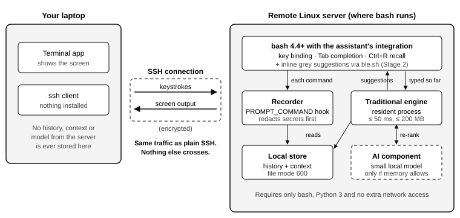

# Where each component runs over SSH

**Principle.** History and context stay on the machine where the shell runs (PDD §9). Over SSH that is the server, so the whole assistant runs there and the laptop needs nothing installed.

| Component | Local use | Over SSH |
|---|---|---|
| Shell integration (zsh line editor: inline suggestions, Tab completion, Ctrl+R recall) | Laptop | Server, with zsh installed there |
| Recorder (zsh `preexec`/`precmd` hooks, redacts secrets first) | Laptop | Server |
| Local store (history and context, file mode 600) | Laptop | Server |
| Traditional engine (resident process, ≤ 50 ms, ≤ 200 MB) | Laptop | Server |
| AI component (small local model: re-ranks; generates on request) | Laptop | Server, only if it has enough memory; otherwise off |

**What crosses the connection.** Only normal terminal traffic: keystrokes from the laptop and screen output from the server, exactly as with plain SSH. No history, context or model traffic.

**The AI component over SSH: options considered**

| Option | Privacy | Feasibility | Decision |
|---|---|---|---|
| A. Model on the server | Context stays on the server | Needs roughly 1–2 GB of free memory for a small quantised model; a free-tier server (about 1 GB in total) cannot spare it | Used when the server can run it |
| B. Model on the laptop, reached through an SSH tunnel | Context (redacted) leaves the server for the laptop | Works on any server | Not planned; only ever an explicit opt-in |
| C. AI off over SSH; traditional engine only | Nothing extra leaves the server | Works on any server | Default when A is not possible |

The AI component is evaluated offline with the replay harness on the laptop (P7), so the evaluation does not depend on which option a server allows.

**Speed over SSH.** The 50 ms target (N1) is measured on the server, from key press to suggestion ready. Network time is excluded, because every keystroke crosses the network with or without the assistant.

**The server's shell.** Most Linux servers default to bash, so Stage 3 installs zsh on the server (one package). Bash itself is supported in Stage 4.

**Order of delivery.** Local zsh on Linux is the core; macOS is Stage 2 and SSH Stage 3 (requirements §2). If SSH is late, the user study runs on a local Linux virtual machine instead.
